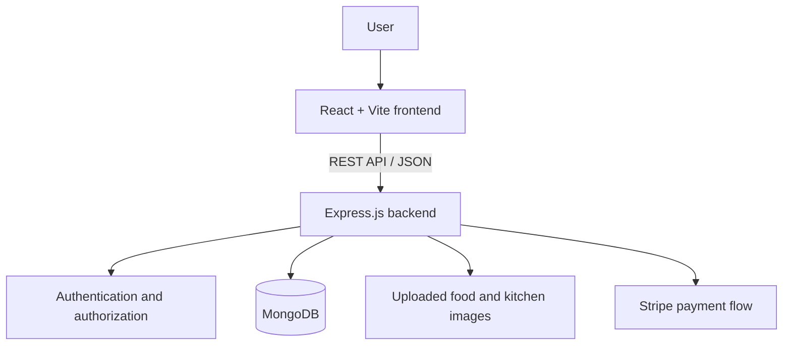

# Maa Si Rasoi 🍲

A full-stack food ordering platform built to help users explore food and kitchens, add items to a cart, place orders, and review their order history.


## Contents

- [Overview](#overview)
- [Features](#features)
- [Tech Stack](#tech-stack)
- [Architecture](#architecture)
- [Project Structure](#project-structure)
- [Getting Started](#getting-started)
- [Environment Configuration](#environment-configuration)
- [Available API Routes](#available-api-routes)
- [Screenshots](#screenshots)
- [Security Notes](#security-notes)
- [Future Improvements](#future-improvements)

## Overview

Maa Si Rasoi is a responsive food-ordering web application with a React frontend and an Express REST API. Food and kitchen data are retrieved from the backend and stored in MongoDB. Authenticated users can manage their cart and access order-related pages.

## Features

- **Food discovery:** Browse the available food menu and filter items by kitchen/category.
- **Kitchen discovery:** Load kitchen listings from the backend.
- **Cart management:** Add and remove items and calculate the cart total.
- **Authentication:** Register and sign in; the backend uses password hashing and token-based authentication.
- **Checkout and orders:** Place orders, verify online payments, and support cash-on-delivery order placement.
- **Order history:** View a user's orders and order status.
- **Image uploads:** Backend endpoints support food and kitchen image uploads.
- **Responsive React UI:** Navigation, login popup, cart, checkout, order history, and footer components.
- **Feedback:** Toast notifications for user actions.

## Tech Stack

| Layer | Technologies |
|---|---|
| Frontend | React 18, Vite, React Router, Axios, Lucide React |
| Backend | Node.js, Express.js |
| Database | MongoDB, Mongoose |
| Authentication | JSON Web Tokens (JWT), bcrypt |
| Payments | Stripe |
| Uploads | Multer |
| UI feedback | React Toastify |

## Architecture



## Project Structure

```text
Maa-Si-Rasoi/
├── frontend/
│   ├── src/
│   │   ├── components/       # Navbar, food cards, footer, login popup
│   │   ├── pages/            # Home, Cart, PlaceOrder, MyOrders, Verify
│   │   ├── Context/          # Shared food, cart, kitchen and auth state
│   │   └── assets/           # Images, icons and styles
│   └── package.json
└── backend/
    ├── config/               # Database connection
    ├── controllers/          # Request handlers
    ├── middleware/           # Authentication middleware
    ├── models/               # Mongoose models
    ├── routes/               # User, food, cart, order and kitchen APIs
    ├── uploads/              # Uploaded images (created/used by backend)
    ├── server.js
    └── package.json
```

## Getting Started

### Prerequisites

Install the following first:

- Node.js (LTS recommended)
- npm
- A MongoDB database (local or MongoDB Atlas)
- Stripe test keys if you want to test online payments

### 1. Clone the repository

```bash
git clone https://github.com/NityaArya30/Maa-Si-Rasoi.git
cd Maa-Si-Rasoi
```

### 2. Configure the backend

```bash
cd backend
npm install
```

Configure your MongoDB connection and payment credentials before starting the server. See [Environment Configuration](#environment-configuration).

Start the backend:

```bash
npm run server
```

The API uses port `4000` by default, unless `PORT` is set. Check `http://localhost:4000/` to confirm the API responds.

### 3. Configure the frontend

Open a second terminal:

```bash
cd frontend
npm install
npm run dev
```

Vite prints the local development URL in the terminal (usually `http://localhost:5173`).

### 4. Create your first data

The app expects food and kitchen data to be available through the backend. Use the project's food/kitchen management endpoints or your existing database setup to add records before testing the menu.

## Environment Configuration

Keep secrets out of source control. Use your own local environment variables and never commit real credentials.

The current backend database connection is defined in `backend/config/db.js`; update it to read a MongoDB connection string from `process.env.MONGODB_URI` before deployment. For example:

```js
import mongoose from "mongoose";

export const connectDB = async () => {
  const uri = process.env.MONGODB_URI;

  if (!uri) {
    throw new Error("MONGODB_URI is not configured");
  }

  await mongoose.connect(uri);
  console.log("MongoDB connected");
};
```

Create a local `backend/.env` file (do not commit it):

```env
PORT=4000
MONGODB_URI=mongodb://127.0.0.1:27017/maa_si_rasoi
JWT_SECRET=replace_with_a_long_random_secret
STRIPE_SECRET_KEY=sk_test_replace_me
```

Use the exact variable names expected by the payment and authentication controllers. Check the source before relying on the sample names above; if the project currently uses different names, align the code and local environment accordingly.

The frontend API base URL is configured in `frontend/src/assets/assets.js`. For local development, it should point to your backend, for example `http://localhost:4000`. Do not put secret keys in frontend code: frontend variables are visible to users.

## Available API Routes

The Express server mounts these route groups under `/api`:

| Route group | Example endpoints | Purpose |
|---|---|---|
| Users | `POST /api/user/register`, `POST /api/user/login` | Registration and login |
| Food | `GET /api/food/list`, `POST /api/food/add`, `POST /api/food/remove` | List and manage food items |
| Kitchens | `GET /api/kitchen/listKitchen`, `POST /api/kitchen/addKitchen`, `POST /api/kitchen/removeKitchen` | List and manage kitchens |
| Cart | `POST /api/cart/get`, `POST /api/cart/add`, `POST /api/cart/remove` | Manage the signed-in user's cart |
| Orders | `POST /api/order/userorders`, `POST /api/order/place`, `POST /api/order/placecod`, `POST /api/order/verify` | Place, verify, and view orders |

Some management and order-status routes may be intended for administrative use. Review the corresponding controller and add appropriate authorization before exposing them publicly.

## Screenshots

Screenshots should show the **real running application**, not mockups. Capture the following screens after starting the frontend and backend:

| Screen | Suggested file |
|---|---|
| Home page with hero and food menu | `screenshots/home.png` |
| Kitchen/category exploration | `screenshots/kitchens.png` |
| Food menu and add-to-cart controls | `screenshots/menu.png` |
| Shopping cart | `screenshots/cart.png` |
| Checkout page | `screenshots/checkout.png` |
| Order history | `screenshots/orders.png` |
| Sign-in / registration popup | `screenshots/login.png` |

Once those images are added to the repository, embed them here using Markdown, for example:

```md


```

## Security Notes

- Do not commit `.env` files, MongoDB credentials, JWT secrets, or Stripe secret keys.
- Replace any placeholder or exposed database connection string and rotate credentials if a real secret was ever committed.
- Restrict CORS to trusted frontend origins for production.
- Protect administrative food/kitchen management and order-status endpoints with authorization.
- Validate request payloads and uploaded files on the server.
- Use HTTPS and Stripe's test mode while developing payment flows.

## Future Improvements

- Add a committed `.env.example` for each app with variable names only.
- Add automated tests for authentication, cart totals, checkout, and order verification.
- Add role-based authorization for administrative routes.
- Improve loading, empty, and error states across pages.
- Add deployment instructions and CI checks.

## Contributing

1. Fork the repository.
2. Create a feature branch: `git checkout -b feature/your-feature`.
3. Commit your changes with a clear message.
4. Open a pull request describing the change.

## License

No license file was detected during this README update. Add a `LICENSE` file if you want to specify how others may use, modify, and distribute the project.
