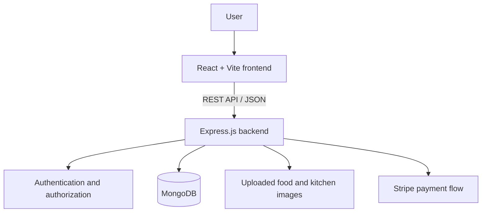

# Maa Si Rasoi 🍲

A full-stack food ordering platform built to help users explore food and kitchens, add items to a cart, place orders, and review their order history.

## This is how the web app looks

The intended web experience uses the existing Maa Si Rasoi flow and highlights each home kitchen separately:

- **Anupma's Rasoi** — traditional homemade meals.
- **Anna's Rasoi** — North Indian favourites.
- **Pinky's Rasoi** — homestyle everyday dishes.

Food cards should clearly identify the kitchen that prepared each item. The same kitchen name should also appear beside each item in the cart and order summary, so customers know which Rasoi each dish belongs to.


## Contents

- [Overview](#overview)
- [Features](#features)
- [Tech Stack](#tech-stack)
- [Architecture](#architecture)
- [Project Structure](#project-structure)
- [Getting Started](#getting-started)
- [Environment Configuration](#environment-configuration)
- [Available API Routes](#available-api-routes)
- [Screenshots](#screenshots)
- [Security Notes](#security-notes)
- [Future Improvements](#future-improvements)

## Overview

Maa Si Rasoi is a responsive food-ordering web application with a React frontend and an Express REST API. Food and kitchen data are retrieved from the backend and stored in MongoDB. Authenticated users can manage their cart and access order-related pages.

## Features

- **Food discovery:** Browse food and filter items by kitchen/category.
- **Kitchen discovery:** Load kitchen listings from the backend.
- **Cart management:** Add and remove items and calculate the cart total.
- **Authentication:** Register and sign in; the backend uses password hashing and token-based authentication.
- **Checkout and orders:** Place orders, verify online payments, and support cash-on-delivery order placement.
- **Order history:** View a user's orders and order status.
- **Image uploads:** Backend endpoints support food and kitchen image uploads.
- **Responsive React UI:** Navigation, login popup, cart, checkout, order history, and footer components.
- **Feedback:** Toast notifications for user actions.

## Tech Stack

| Layer | Technologies |
|---|---|
| Frontend | React 18, Vite, React Router, Axios, Lucide React |
| Backend | Node.js, Express.js |
| Database | MongoDB, Mongoose |
| Authentication | JSON Web Tokens (JWT), bcrypt |
| Payments | Stripe |
| Uploads | Multer |
| UI feedback | React Toastify |

## Architecture



## Project Structure

```text
Maa-Si-Rasoi/
├── frontend/
│   ├── src/
│   │   ├── components/       # Navbar, food cards, footer, login popup
│   │   ├── pages/            # Home, Cart, PlaceOrder, MyOrders, Verify
│   │   ├── Context/          # Shared food, cart, kitchen and auth state
│   │   └── assets/           # Images, icons and styles
│   └── package.json
└── backend/
    ├── config/               # Database connection
    ├── controllers/          # Request handlers
    ├── middleware/           # Authentication middleware
    ├── models/               # Mongoose models
    ├── routes/               # User, food, cart, order and kitchen APIs
    ├── uploads/              # Uploaded images (created/used by backend)
    ├── server.js
    └── package.json
```

## Getting Started

### Prerequisites

- Node.js (LTS recommended)
- npm
- A MongoDB database (local or MongoDB Atlas)
- Stripe test keys if you want to test online payments

### 1. Clone the repository

```bash
git clone https://github.com/NityaArya30/Maa-Si-Rasoi.git
cd Maa-Si-Rasoi
```

### 2. Configure the backend

```bash
cd backend
npm install
npm run server
```

Configure your MongoDB connection and payment credentials before starting the server. The API uses port `4000` by default unless `PORT` is set.

### 3. Configure the frontend

Open a second terminal:

```bash
cd frontend
npm install
npm run dev
```

Vite prints the local development URL in the terminal (usually `http://localhost:5173`).


## Available API Routes

| Route group | Example endpoints | Purpose |
|---|---|---|
| Users | `POST /api/user/register`, `POST /api/user/login` | Registration and login |
| Food | `GET /api/food/list`, `POST /api/food/add`, `POST /api/food/remove` | List and manage food items |
| Kitchens | `GET /api/kitchen/listKitchen`, `POST /api/kitchen/addKitchen`, `POST /api/kitchen/removeKitchen` | List and manage kitchens |
| Cart | `POST /api/cart/get`, `POST /api/cart/add`, `POST /api/cart/remove` | Manage the signed-in user's cart |
| Orders | `POST /api/order/userorders`, `POST /api/order/place`, `POST /api/order/placecod`, `POST /api/order/verify` | Place, verify, and view orders |

Review management and order-status routes for proper authorization before exposing them publicly.

## Screenshots

### Maa Si Rasoi — homepage banner


*Homepage banner image currently included in the project assets.*

> These are existing images from the repository, so they render directly on GitHub. They are project assets rather than screenshots captured from a running app. Add real page screenshots here once the application is running.

## Contributing

1. Fork the repository.
2. Create a feature branch: `git checkout -b feature/your-feature`.
3. Commit your changes with a clear message.
4. Open a pull request describing the change.

