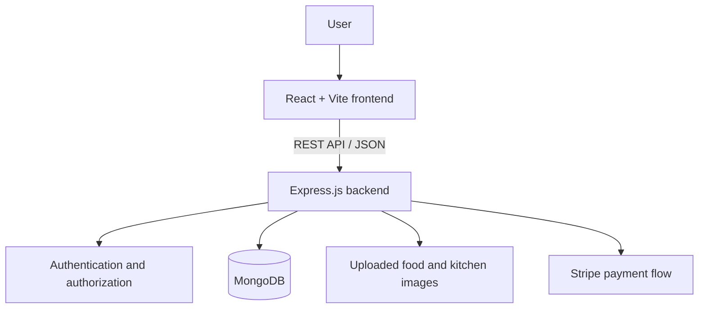

# Maa Si Rasoi 🍲

A full-stack food ordering platform built to help users explore food and kitchens, add items to a cart, place orders, and review their order history.

> **How the web app looks:** Maa Si Rasoi is designed around home-style Indian food and multiple home kitchens, including Anupma's Rasoi, Anna's Rasoi, and Pinky's Rasoi. The intended experience includes kitchen-specific menus, food cards that identify their kitchen, a cart that keeps the kitchen name visible for every item, checkout, and order history.

## Contents

- [Overview](#overview)
- [Features](#features)
- [Web App Design](#web-app-design)
- [Tech Stack](#tech-stack)
- [Architecture](#architecture)
- [Project Structure](#project-structure)
- [Getting Started](#getting-started)
- [Environment Configuration](#environment-configuration)
- [Available API Routes](#available-api-routes)
- [Screenshots](#screenshots)
- [Security Notes](#security-notes)
- [Future Improvements](#future-improvements)

## Overview

Maa Si Rasoi is a responsive food-ordering web application with a React frontend and an Express REST API. Food and kitchen data are retrieved from the backend and stored in MongoDB. Authenticated users can manage their cart and access order-related pages.

## Features

- **Food discovery:** Browse the available food menu and filter items by kitchen/category.
- **Kitchen discovery:** Load kitchen listings from the backend.
- **Cart management:** Add and remove items and calculate the cart total.
- **Authentication:** Register and sign in; the backend uses password hashing and token-based authentication.
- **Checkout and orders:** Place orders, verify online payments, and support cash-on-delivery order placement.
- **Order history:** View a user's orders and order status.
- **Image uploads:** Backend endpoints support food and kitchen image uploads.
- **Responsive React UI:** Navigation, login popup, cart, checkout, order history, and footer components.
- **Feedback:** Toast notifications for user actions.

## Web App Design

The intended web experience follows this flow:

```text
Home
 └── Explore Kitchens
      ├── Anupma's Rasoi
      ├── Anna's Rasoi
      └── Pinky's Rasoi
           └── Kitchen-specific menu
                └── Add to Cart (kitchen name stays visible)
                     └── Cart
                          └── Checkout
                               └── My Orders
```

Each food card should clearly display the kitchen it comes from. The same kitchen name should also appear beside the item in the cart and order summary, so customers know which home kitchen is preparing each dish.

**Design reference image:** The latest generated concept is a visual mockup, not a screenshot from a running build. It still needs to be added as `docs/maa-si-rasoi-design.png` before it can be embedded here. The mockup should not be described as a real running-app screenshot.

## Tech Stack

| Layer | Technologies |
|---|---|
| Frontend | React 18, Vite, React Router, Axios, Lucide React |
| Backend | Node.js, Express.js |
| Database | MongoDB, Mongoose |
| Authentication | JSON Web Tokens (JWT), bcrypt |
| Payments | Stripe |
| Uploads | Multer |
| UI feedback | React Toastify |

## Architecture



## Project Structure

```text
Maa-Si-Rasoi/
├── frontend/
│   ├── src/
│   │   ├── components/       # Navbar, food cards, footer, login popup
│   │   ├── pages/            # Home, Cart, PlaceOrder, MyOrders, Verify
│   │   ├── Context/          # Shared food, cart, kitchen and auth state
│   │   └── assets/           # Images, icons and styles
│   └── package.json
├── admin/                    # Admin dashboard
└── backend/
    ├── config/               # Database connection
    ├── controllers/          # Request handlers
    ├── middleware/           # Authentication middleware
    ├── models/               # Mongoose models
    ├── routes/               # User, food, cart, order and kitchen APIs
    ├── uploads/              # Uploaded images (created/used by backend)
    ├── server.js
    └── package.json
```

## Getting Started

### Prerequisites

- Node.js (LTS recommended)
- npm
- A MongoDB database (local or MongoDB Atlas)
- Stripe test keys if you want to test online payments

### 1. Clone the repository

```bash
git clone https://github.com/NityaArya30/Maa-Si-Rasoi.git
cd Maa-Si-Rasoi
```

### 2. Configure the backend

```bash
cd backend
npm install
npm run server
```

Configure your MongoDB connection and payment credentials before starting the server. The API uses port `4000` by default, unless `PORT` is set.

### 3. Configure the frontend

Open a second terminal:

```bash
cd frontend
npm install
npm run dev
```

Vite prints the local development URL in the terminal (usually `http://localhost:5173`).

## Environment Configuration

Keep secrets out of source control. Use your own local environment variables and never commit real credentials.

The backend database connection is defined in `backend/config/db.js`; configure it to use an environment variable such as `MONGODB_URI`. Store local values in `backend/.env` and never commit the file. Check the source code for the exact variable names expected by the current backend.

The frontend API base URL is configured in `frontend/src/assets/assets.js`. Do not put secret keys in frontend code: frontend variables are visible to users.

## Available API Routes

The Express server mounts these route groups under `/api`:

| Route group | Example endpoints | Purpose |
|---|---|---|
| Users | `POST /api/user/register`, `POST /api/user/login` | Registration and login |
| Food | `GET /api/food/list`, `POST /api/food/add`, `POST /api/food/remove` | List and manage food items |
| Kitchens | `GET /api/kitchen/listKitchen`, `POST /api/kitchen/addKitchen`, `POST /api/kitchen/removeKitchen` | List and manage kitchens |
| Cart | `POST /api/cart/get`, `POST /api/cart/add`, `POST /api/cart/remove` | Manage the signed-in user's cart |
| Orders | `POST /api/order/userorders`, `POST /api/order/place`, `POST /api/order/placecod`, `POST /api/order/verify` | Place, verify, and view orders |

Review management and order-status routes for proper authorization before exposing them publicly.

## Screenshots

Add screenshots captured from the **real running application** under `screenshots/` and embed them here. The generated design mockup should be labelled as a design reference, not a live application screenshot.

## Security Notes

- Do not commit `.env` files, MongoDB credentials, JWT secrets, or Stripe secret keys.
- Replace any exposed database connection string and rotate credentials if a real secret was committed.
- Restrict CORS to trusted frontend origins for production.
- Protect administrative food/kitchen management and order-status endpoints with authorization.
- Validate request payloads and uploaded files on the server.
- Use HTTPS and Stripe's test mode while developing payment flows.

## Future Improvements

- Add a committed `.env.example` for each app with variable names only.
- Add automated tests for authentication, cart totals, checkout, and order verification.
- Add role-based authorization for administrative routes.
- Improve loading, empty, and error states across pages.
- Add deployment instructions and CI checks.

## Contributing

1. Fork the repository.
2. Create a feature branch: `git checkout -b feature/your-feature`.
3. Commit your changes with a clear message.
4. Open a pull request describing the change.

## License

No license file was detected during this README update. Add a `LICENSE` file if you want to specify how others may use, modify, and distribute the project.
